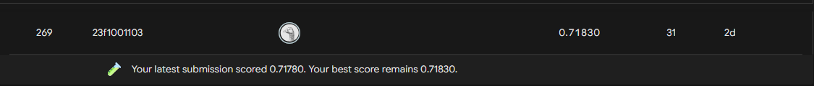
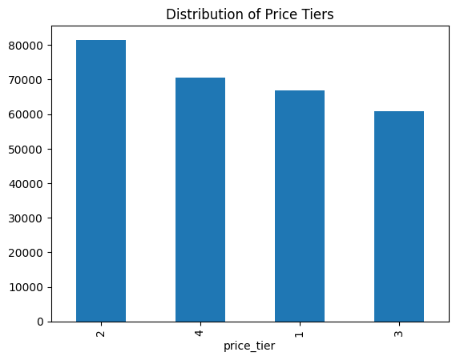

# Workstation Rental Price Tier Prediction

**IIT Madras BS Degree · Machine Learning Practice (MLP) · September 2026**

A machine-learning project that predicts one of four price tiers for commercial workstation listings. The work focuses on exploratory data analysis, high-cardinality feature engineering, leakage-aware validation, and an ensemble of gradient-boosting models.

> **Competition placement:** 269th among 3,000+ participants (approximately top 9%).  
> **Final private-leaderboard score:** **0.71780**  
> **Final out-of-fold (OOF) accuracy:** **0.72083** using 5-fold GroupKFold validation.
>
> The competition was conducted in a private academic setting. Competition URLs, hosted-notebook links, restricted data, and other private competition materials are intentionally not included in this repository.

## Project evidence

### Competition leaderboard



*Leaderboard screenshot captured from the private competition. The screenshot is included as evidence; no competition URL is shared.*

### Target distribution



*Distribution of the four target classes in the training data.*

## 1. Problem statement

The task is a **four-class classification problem**: predict `price_tier` (Tier 1, 2, 3, or 4) from information about each commercial workspace listing. Although the target tiers have an order, the submitted task is classification rather than continuous-price regression.

The training data contains **279,746 listings** and **59 input features**. Features describe listing capacity, location, operators, facilities, booking availability, and reviews. The competition data is not included in this repository.

## 2. Results

| Measure | Result | Context |
|---|---:|---|
| Competition rank | **269th of 3,000+** | Private competition leaderboard; see screenshot above |
| Final competition score | **0.71780** | Final selected submission |
| OOF accuracy | **0.72083** | 5-fold GroupKFold validation; not the leaderboard score |
| Dummy baseline accuracy | 0.2914 | Majority-class baseline |
| Engineered feature count | 292 | Final feature representation documented in the project notes |

The leaderboard score and OOF accuracy are reported separately because they come from different evaluation settings and should not be treated as the same metric.

## 3. Approach

1. **Exploratory data analysis:** examined the target distribution, missingness, skewed numerical variables, categorical cardinality, and the structure of the facilities field.
2. **Baseline experiments:** established a majority-class baseline, then evaluated linear, neural-network, and tree-based approaches.
3. **Facility representation:** identified that 251,649 distinct facilities JSON combinations were composed of only 144 individual facility codes. The facility field was unpacked into individual indicators and represented using multi-label encoding and 12 TruncatedSVD components.
4. **Feature engineering:** created additional features and group-level aggregates using operator, building/location, zone, and metro information, alongside capacity, booking, and date-derived ratios. The final feature representation contained 292 features.
5. **Leakage-aware validation:** used 5-fold GroupKFold grouped by operator. Nested out-of-fold target encoding was used for high-cardinality categorical features to reduce target leakage between training and validation folds.
6. **Ensembling:** combined HistGradientBoosting, LightGBM, XGBoost, and CatBoost model families through soft voting. Class-probability multiplier tuning was used to improve minority Tier 3 recall.

## 4. Selected experimental progression

| Experiment | Evaluation setup | Accuracy / result | What it showed |
|---|---|---:|---|
| DummyClassifier | Baseline reference | 0.2914 | Established the majority-class baseline |
| Logistic Regression | Initial stratified holdout | 0.6272 | Linear decision boundaries did not capture the full signal |
| MLPClassifier | Initial stratified holdout | 0.6677 | Captured some non-linearity, but remained below tree-based models |
| HistGradientBoosting | Initial stratified holdout | 0.7138 | Tree boosting handled non-linear relationships more effectively |
| Final soft-voting ensemble | 5-fold GroupKFold, grouped by operator | **0.72083 OOF accuracy** | Combined complementary boosting model families under group-aware validation |
| Final selected submission | Private competition leaderboard | **0.71780 score** | Final competition result |

The early holdout experiments and final grouped OOF evaluation use different validation setups. Their scores are useful for understanding the experiment progression, but are not a perfectly like-for-like benchmark.

## 5. Important engineering decisions

- **Unpacked the facilities field:** treating each complete JSON string as a category would create extremely high cardinality. Decomposing it exposed a much smaller vocabulary of 144 individual facility codes.
- **Checked train/test entity overlap:** only 36.0% of test operators were also present in training, while 87.25% of test building coordinates were represented in training. This informed the validation and feature-engineering strategy.
- **Grouped validation by operator:** GroupKFold was used to reduce optimistic validation caused by the same operator appearing in both training and validation folds.
- **Used out-of-fold target encoding:** high-cardinality categorical features were target-encoded within the group-aware validation procedure to reduce leakage.
- **Tuned minority-class behaviour:** class-probability multipliers increased Tier 3 recall from 0.5337 to 0.5583 in the final project notes.

## 6. Repository structure

```text
workstation-rental-price-tier-prediction/
├── README.md
├── .gitignore
├── requirements.txt
├── notebooks/
│   ├── README.md
│   └── workstation_rental_price_tier_prediction.ipynb
├── assets/
│   ├── README.md
│   ├── leaderboard-rank.png
│   └── target-distribution.png
└── reports/
    └── experiment-log.md
```

The notebook filename above is the intended name for the final, cleaned notebook. Add the actual `.ipynb` file to `notebooks/` before considering the repository complete. Add future plots to `assets/` only when they are generated from and checked against the final notebook outputs.

## 7. Notebook and reproducibility

The notebook is the primary technical record of the project: it should show the analysis, experiments, preprocessing, feature engineering, validation strategy, final ensemble, and evaluation outputs.

The competition dataset is **not included** because it is private/restricted. As a result, the notebook cannot be run end-to-end from this repository alone. Reproduction requires separately authorized access to the data and, where necessary, updating the notebook's input paths for the local environment. Do not add private dataset files, access tokens, credentials, or competition-only materials to this repository.

The notebook is an academic competition project, not a deployed production pricing service.

## 8. Technologies

- **Language and data:** Python, pandas, NumPy
- **Machine learning:** scikit-learn, SciPy
- **Gradient boosting:** HistGradientBoosting, LightGBM, XGBoost, CatBoost
- **Feature engineering:** MultiLabelBinarizer, TruncatedSVD, target encoding, group-level aggregations
- **Development:** Jupyter Notebook

## 9. Scope and sharing note

This repository is a portfolio presentation of the project and its permitted supporting material. The private competition's URLs, hosted notebook, restricted dataset, credentials, and confidential instructions are intentionally omitted. Only publish notebook code and screenshots that you are permitted to share under the applicable course and competition rules.
